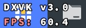
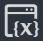
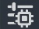
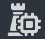
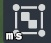

界面控件组管理  $ \times $ 资产导入导出管理  $ \times $

PU: 46%

输入探针v2

一

关卡设置

界面控件组管理

主镜头管理

多人试玩

外围系统管理

货币与背包

奇域礼盒管理

角色预览管理

计时器管理

关卡变量管理

预设点管理

技能资源管理

背景音乐管理

资产导入导出管理

装备数据管理

商店模板管理

高级数据管理

局内存档管理

试玩临时数据管理

实体布设组管理 max: 20.0 ms

737111

