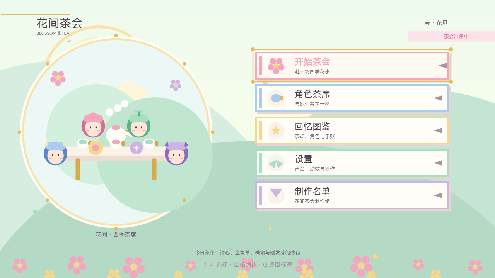
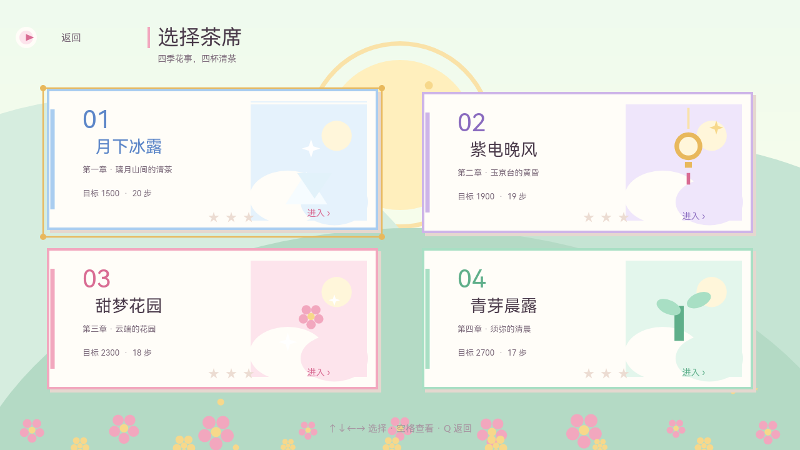
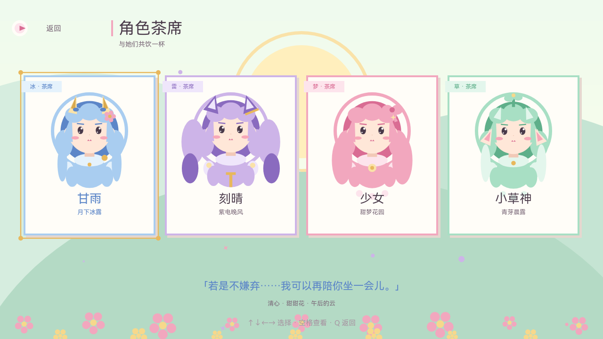
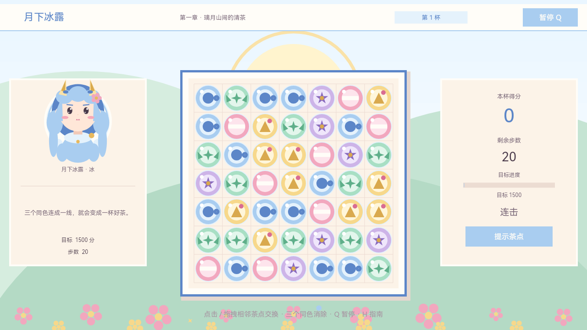
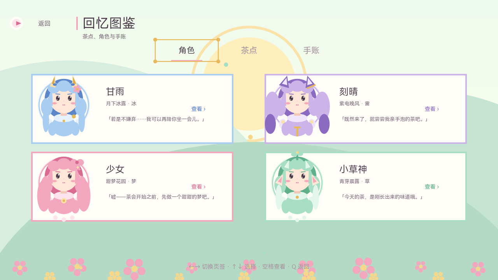
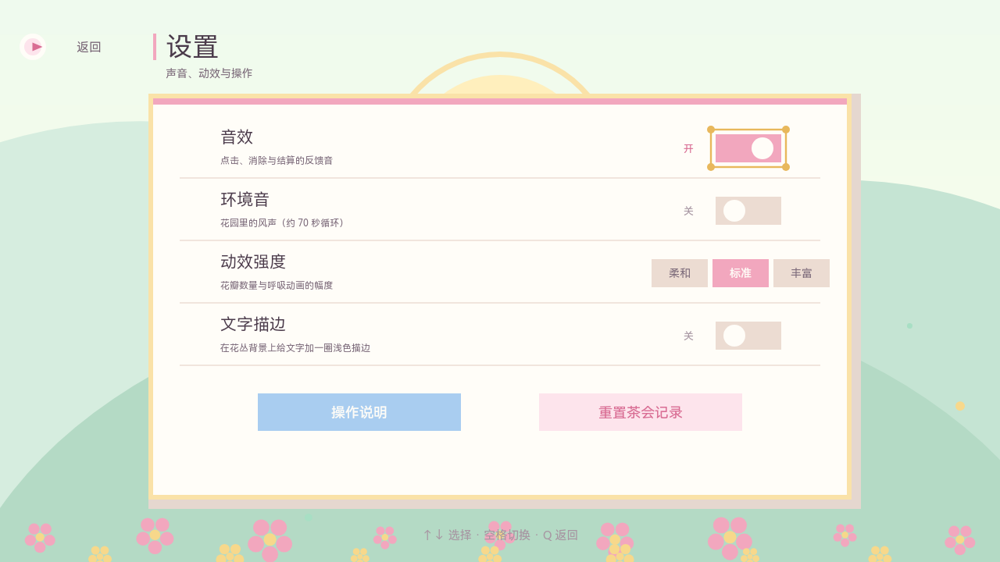
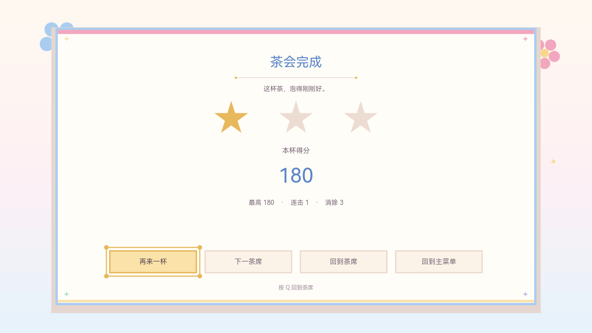
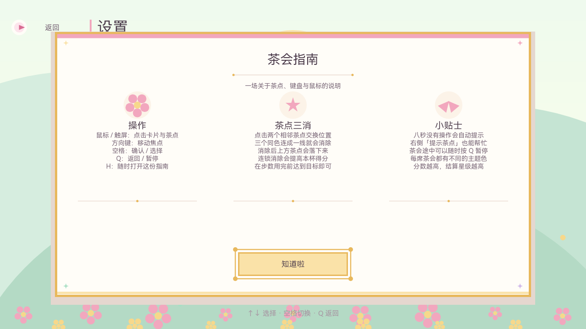

# 花间茶会 · Blossom & Tea

> 四季花事，一席清茶。  
> 一款用千星模拟器「2D UI + Lua」从零搭起来的可爱茶会游戏壳：**完整菜单 + 可交互的茶席 + 一局 7×7 茶点三消**。  
> 美术全部由六种图元（rect / circle / triangle / fourstar / fivestar / ring）现场拼成，没有外部贴图。

> **本机环境（2026-10-28 用户纠正）**：Arch Linux + Wine prefix，不是 Win11。真实存档在
> `/home/h/.local/share/anime-game-launcher/prefix/drive_c/users/h/AppData/LocalLow/miHoYo/原神/BeyondLocal/`；
> `/mnt/wingames` 是只读旧镜像，不要写。


## 这是什么

用户给的四个关键字是 **甘雨 / 刻晴 / 少女 / 小草神**。项目把她们做成四席茶会的主人：

| 茶席 | 主人 | 主题色 | 茶席目标 |
|---|---|---|---|
| 月下冰露 | 甘雨 | 冰蓝 | 1500 分 · 20 步 |
| 紫电晚风 | 刻晴 | 紫电 | 1900 分 · 19 步 |
| 甜梦花园 | 少女 | 甜粉 | 2300 分 · 18 步 |
| 青芽晨露 | 小草神 | 青芽 | 2700 分 · 17 步 |

按用户「游戏内容先不做，终点是游戏交互和各种可能的功能，菜单设计要完整」的要求，**主体是游戏壳与交互系统**；玩法只做了一局可玩的茶点三消作为「茶席试玩」，四席用同一套三消规则 + 四套主题色/棋盘目标。它不是一个只画了菜单的静态稿。

## 现在能做什么

- 标题页：Logo、四位角色徽章、花瓣飘落、开始提示。
- 主菜单：开始茶会 / 角色茶席 / 回忆图鉴 / 设置 / 制作名单，五张卡片全部可点、可键盘导航。
- 茶席选择：四张章节卡，选中浮起，进入章节详情（目标、步数、角色、小景）。
- 角色茶席：四位角色立绘卡、焦点切换时更新台词与喜好。
- 角色详情：大立绘、称号、元素、台词、简介、喜欢的东西、三条小属性、开始茶席。
- 回忆图鉴：角色 / 茶点 / 手账三个页签；茶点详情、四席记录、五条成就。
- 设置：音效、环境音、动效强度、文字描边、操作说明、重置记录（带二次确认）。
- 帮助：一份三栏茶会指南，游戏内按 H 随时打开，打开时暂停对局。
- 制作名单：静态名单 + 特别感谢。
- 对局：7×7 三消、点击/拖拽/键盘三套输入、连锁、提示、暂停、结算、再来一杯/下一茶席。
- 通用交互：转场、Toast、确认弹窗、焦点框、鼠标悬停、按下/点击音效、结算星级、手账解锁提示。
- 多画布：按 `S=min(W/1280,H/720)` 整体缩放；已验证 1280×720、1600×900、1280×960。

| 主菜单 | 茶席选择 |
|---|---|
|  |  |

| 角色茶席 | 对局 |
|---|---|
|  |  |

| 图鉴 | 设置 |
|---|---|
|  |  |

| 结算 | 帮助 |
|---|---|
|  |  |

更多截图在 [`docs/preview/`](preview/)：章节详情、角色详情、茶点详情、暂停、确认框、制作名单，以及 1600×900 的整组 `-pc` 版本。


## 模拟器里试玩（已追加到存档列表）

工程已复制到模拟器 Web 的工作区，存档名 **花间茶会**：

```bash
# 重新追加/覆盖（模拟器服务器不需要重启）
cd /home/h/genshin-ts/workspace/flower-tea
bash qxqy/install-sim-save.sh
```

文件：`/home/h/qxqy-workspace/花间茶会.save.json`（132,613 B，`meta.name=花间茶会`）。
打开 **http://127.0.0.1:4173** → 存档选择器 → 选「花间茶会」；如果页面之前已经开着，**刷新一次**（存档列表是页面加载时拉的）。
推荐画布：`mobile-16-9`（1280×720）或 `pc-16-9`（1600×900），两套都已跑过 22 条回归和整流程出图。

## 进入游戏

### 1. 模拟器（最快，已验证）

依赖：本机千星模拟器 `/home/h/miliastra-beyond-simulator`、Node 22+、lua5.3。

```bash
cd /home/h/genshin-ts/workspace/flower-tea

# 从 lua/src/*.lua 拼接并注入模板 GUID，产出 save + 整合包 GIA
node qxqy/build.mjs

# 离线回归：22 条用例（含鼠标点击、拖拽、键盘、暂停、结算、设置、图鉴、三张画布）
node qxqy/runner.mjs

# 真实渲染出图到 docs/preview/（整流程，0 错误才算过）
node qxqy/shot.mjs
node qxqy/shot.mjs pc-16-9
```

当前读数：**22/22 用例通过，约 5s；两组出图共 40 张，0 errors**。

### 2. 真实地图（已创建，待你在游戏内确认）

已创建真实地图 **`1073741839` · 花间茶会**，并已把模板、宿主容器、Lua 脚本、脚本挂载直接写进地图（不依赖 GIA 导入）：

| 项 | 值 |
|---|---|
| 地图 ID | `1073741839` |
| 地图文件 | `…/BeyondLocal/110170759/Beyond_Local_Save_Level/1073741839.gil` |
| Temp | `…/BeyondLocal/110170759/Temp/1073741839.gil` |
| 模板 | `1073741910` image / `1073741911` textbox / `1073741912` cursor |
| 脚本 | `1073741825` · `flower_main` · `default_import_file/flower/main.lua` |
| 宿主 | `1073741901` · 容器节点（布局:默认布局:客户端控件容器#1） |
| 写后大小 / sha | 145,429 B / `201dc7c167df2b455b2fcd3c31a6c90e7651a1a452595c512c5a307c213b1ab2` |
| Save_Level = Temp | 是，同 sha |
| `gil-guard.py` | PASS（字段序 / 501 根集 / children 闭合 / Temp 同步） |

打开方式：在编辑器存档列表里找到 **「花间茶会」** 打开，直接试玩。

> ⚠️ 创建时编辑器和游戏都在运行，编辑器内存里的地图列表可能还是旧的。**如果列表里暂时没有这张图**：先切到存档管理刷新（或重开编辑器），不要覆盖 / 重存任何其他地图。CLI 写盘后，编辑器需要重新打开该地图才会读到盘外写入（CLI 原话：`编辑器需重开地图才会读到盘外写入`）。
>
> ⚠️ **真机/编辑器内的实际打开与试玩尚未执行**。这次已验证的是：地图结构、脚本登记、挂载、Save/Temp 同 sha、guard PASS、模拟器 22/22。请把「真实地图能否打开、标题页是否出现、按键/鼠标是否工作」作为最后一栏人工确认；如果出现空白或异常，请把游戏日志里以 `[tea]` 开头的行发我。

GIA 备份也放到了游戏导出目录，万一要改走 GIA 导入路线：

`BeyondLocal/Beyond_Local_Export/花间茶会-整合包.gia`（124,539 B）

## 操作

| 输入 | 作用 |
|---|---|
| 鼠标 / 触屏 | 悬停 / 点击卡片、按钮、茶点；拖动相邻茶点交换 |
| 方向键 / WASD | 移动焦点；对局中移动棋盘光标 |
| 空格 / F | 确认 / 选择；对局中先选茶点、再按一次交换 |
| Q / Backspace | 返回；对局中暂停；弹层中关闭 |
| H | 打开 / 关闭《茶会指南》 |
| T | 调试：直接结束当前对局（仅用于回归用例） |

对局规则：点击两个相邻茶点交换；三个同色连成一线消除；上方茶点落下并补充；连锁会乘算得分。步数用完前达到目标即完成茶席，分数达到目标 1.25× / 1.5× 分别拿 2 / 3 星。

## 工程结构

```
flower-tea/
├── lua/src/                  # 唯一逻辑真源（按文件名排序拼接）
│   ├── 00_config.lua         # 角色/章节/茶点/成就/音效/调色板
│   ├── 10_core.lua           # 画布缩放、控件工厂、焦点、补间、弹层、转场、音效
│   ├── 20_art.lua            # 背景、立绘、茶桌、标题、茶点、花瓣
│   ├── 30_screens.lua        # 标题/主菜单/茶席/角色/图鉴/设置/名单
│   ├── 35_overlays.lua       # 章节/角色/茶点详情、确认、暂停、结算、帮助
│   ├── 40_game.lua           # 7×7 三消
│   └── 50_main.lua           # OnStart/OnUpdate/键位/模板探测与自动发现
├── lua/main.lua              # build 生成的拼接产物（不要手改）
├── qxqy/build.mjs            # 模拟器工程：3 模板 + 脚本 → save + GIA
├── qxqy/build-device.mjs     # 真实地图 Lua：注入已知模板 GUID
├── qxqy/runner.mjs           # 22 条离线用例
├── qxqy/shot.mjs             # 全流程真实渲染出图
├── qxqy/patch-template-refs.py # 修 template clone 残留的 donor 自引用
├── tests/                    # 01..22 JSON 用例
├── device-package/           # 设备 Lua / 整合包 / 初始地图备份
└── docs/                     # 本说明、验收报告、截图
```

### 三条关键实现事实

1. **每屏「图片 → 全部文字 → 热区 → 焦点框」建一层**。运行时实例后建在上；服务端 textbox 永远在实例层下面。换屏用 `DestroyClientUIControl` 真销毁，不靠 `SetVisible`（真机对运行时实例不可靠）。
2. **整屏只依赖 3 个客户端模板**：image / textbox / cursor。模拟器注入 authoring GUID；真实地图注入真机模板 GUID。如果 GUID 被编辑器重编号，`T.discoverTemplates()` 会在 `1073741825..1073742050` / `1073742100..1073742150` 两段里按「能力」探测（`SetImage` / `text` / `AddCursorEventListener` 且不是 button），自动找替代模板。
3. **不依赖图片 alpha 做任何关键视觉**。渐变用 16 条实色带，阴影用实色块，淡入淡出只走已验证的 `fontColor` alpha。所有平台 API 包 `pcall` + 带名日志 `[tea]`。

## 验证三栏（摘要）

### ① 已验证

- **模拟器行为层**：`node qxqy/runner.mjs` → **22/22 PASS，4.7s**。覆盖启动/标题、键盘焦点、茶席详情→开局、鼠标交换、拖拽交换、键盘交换、提示、暂停/继续、设置开关、图鉴三页签与茶点详情、角色详情、结算/再来一杯/下一茶席、局内帮助暂停、回主菜单二次确认、PC 1600×900 与 4:3 画布。
- **模拟器结构层**：`node qxqy/build.mjs` 自检 GIA 可重新 `importGia()`，3 模板 / 1 脚本；`node qxqy/shot.mjs` 两组共 40 张 PNG，`shot errors=0`。
- **地图结构层**：`gil-guard.py <map> --temp <Temp>` PASS；Save_Level 与 Temp 同 sha `5a2bb88d…`；`assets:scripts list` 1 条、`mounts` host=1073741901、`assets:ui template list` 含 3 个模板、`assets:ui list` 含宿主容器。

### ② 未验证

- **真实地图在编辑器/游戏内的打开、试玩、鼠标/键盘、音频**：未执行；上面 ① 的地图项全是结构层。
- **编辑器重编号后模板自动发现是否覆盖你机器上的实际编号**：范围/能力探测逻辑已写，但未在真机跑过。
- **环境音 10002 的实际听感**、以及所有音效 id 的语义：来自 tetris 已测白名单 + 按时长挑的占位，未逐条试听。
- **跨会话持久化**：Lua 侧没有存档 API；记录/设置只在当前运行期有效。
- **官方 HUD（小地图/队伍信息等）是否被全屏背景完全盖住**：结构上宿主容器后建，应该在上面；未在真机确认。

### ③ 需要你在游戏内确认

- [ ] 存档列表里能看到「花间茶会」，打开后标题页出现
- [ ] 鼠标点「点击开始茶会」→ 主菜单
- [ ] 键盘 ↑↓ / 空格 / Q 在菜单里工作
- [ ] 进入第一席，点击两个相邻茶点能交换、消除、加分
- [ ] 拖拽交换也能工作
- [ ] Q 能暂停，继续能回来
- [ ] 结算页出现，再来一杯/下一茶席能走
- [ ] 设置里的音效/环境音/动效/描边有实际效果
- [ ] 整体画面没有官方 HUD 盖在游戏上面

详细命令、读数与文件哈希见 [`验收报告.md`](验收报告.md)；页面流程、状态机、美术系统与数值见 [`设计说明.md`](设计说明.md)。  
模拟器卡顿/帧率判读见 [`性能诊断.md`](性能诊断.md)。

## 模板重编号时

如果编辑器把模板重编号，标题页可能空白，日志会出现 `discover incomplete` 或 `probe ... FAIL`。先离开该地图，再跑：

```bash
cd /home/h/genshin-ts/workspace/flower-tea
bash qxqy/calibrate-device.sh 1073741839 1073741825
```

它会按名字读取 `flower_prim/label/hit` 的当前 id、重生成 `device-package/main-device.lua`、更新脚本、跑 `gil-guard`。执行前务必让编辑器离开该地图（编辑器会把内存版写回磁盘）。

## 更新真实地图的 Lua

改完 `lua/src/*.lua` 后：

```bash
cd /home/h/genshin-ts/workspace/flower-tea

# 1) 生成设备版（模板 GUID 用当前地图的；如果编辑器重编号过，先跑
#    gsts assets:ui template list --gil <map> 拿到新 id）
FLOWER_PRIM=1073741910 FLOWER_LABEL=1073741911 FLOWER_HIT=1073741912 \
  node qxqy/build-device.mjs

# 2) 写回脚本（--map-id 会同时同步 Temp；编辑器需重新打开地图）
export GSTS_LOCALLOW_DIR=/home/h/.local/share/anime-game-launcher/prefix/drive_c/users/h/AppData/LocalLow
unset LOCALAPPDATA
node /home/h/genshin-ts/dist/src/cli/gsts.js assets:scripts update \
  --map-id 1073741839 --guid 1073741825 \
  --source-file device-package/main-device.lua --write

# 3) 安全门
python3 /home/h/genshin-ts/tools/gil-guard.py \
  "$GSTS_LOCALLOW_DIR/miHoYo/原神/BeyondLocal/110170759/Beyond_Local_Save_Level/1073741839.gil" \
  --temp "$GSTS_LOCALLOW_DIR/miHoYo/原神/BeyondLocal/110170759/Temp/1073741839.gil"
```

> 不要用 `lua/main.lua` 去 update 真机脚本：它的模板 GUID 是模拟器值；要传 `device-package/main-device.lua`。

## 已知边界 / 下一步

- 美术是「纯图元剪纸风」，不是官方立绘；角色是可爱化再创作。没有使用任何官方图片/字体/音频文件。
- 三消只有一套基础规则（无特殊块/道具/障碍）；四席靠主题色、目标、步数区分。用户说内容先不做，这是有意控制的范围。
- 记录/成就是**本次运行内**的；要跨会话持久化，需要地图变量 + 服务端图（下一步）。
- 音量 API 只有 `PlayAudio2D` / `StopAudio`，没有音量接口；设置里只做开关。
- 真实地图如果出现空白：先看日志里有没有 `[tea] onstart`；有日志但无模板 → 跑模板 list 后按新 GUID 更新脚本；没日志 → 查脚本挂载/宿主容器是否在活动布局。
- 地图备份：`device-package/1073741839.base.gil`（加模板前的 21,255 B 初始图），CLI 的 `.gsts/backups/` 也有每一步备份。

## 致谢

- 四位角色与《原神》世界观版权归 miHoYo / HoYoverse；本项目是非商业的粉丝向技术 demo，角色立绘与文案为原创简化再创作。
- 模拟器：[miliastra-beyond-simulator](https://github.com/1475505/miliastra-beyond-simulator)（本机 `/home/h/miliastra-beyond-simulator`）。
- 工具链：Genshin-TS `gsts`（`/home/h/genshin-ts`）。
